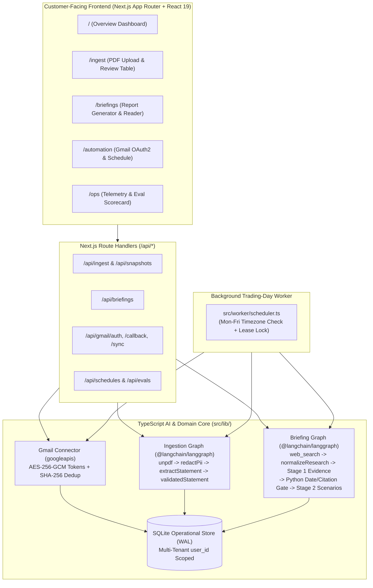

# LedgerPulse — High-Level Design (HLD)

**LedgerPulse** is the production-grade TypeScript & Next.js sister application to `portfolio-briefing-agent`. It replaces the single-user local Streamlit/Python prototype with a multi-tenant web application, automated Gmail IBKR Daily Activity Statement ingestion, a background trading-day scheduler, and Docker/VPS deployment.

---

## 1. System Topology

---

## 2. Python-to-TypeScript Migration Map

| Capability | `portfolio-briefing-agent` (Python) | `LedgerPulse` (TypeScript) |
|---|---|---|
| **Web UI** | `app.py` (Streamlit, localhost-only) | Next.js 15 App Router + React 19 + Tailwind CSS (`src/app/*`) |
| **Schema & Invariants** | `portfolio_agent/models.py` (Pydantic v2) | `src/lib/agent/models.ts` (Strict Zod + `zodResponseFormat`) |
| **PDF Parsing & PII** | `pypdf` + regex (`services.py`) | `unpdf` + `redactPii()` (`src/lib/agent/services.ts`, `src/lib/telemetry.ts`) |
| **Orchestration** | `langgraph` Python `StateGraph` | `@langchain/langgraph` TypeScript `StateGraph` (`src/lib/agent/workflow.ts`) |
| **Web Search & Synthesis** | `ChatOpenAI` + `web_search` | `openai.responses.create` (`web_search_preview`, `max_tool_calls: 2`, `store: false`) |
| **Email Ingestion** | Manual upload only | `googleapis` Gmail OAuth2 (`gmail.readonly`) + SHA-256 deduplication (`src/lib/gmail/client.ts`) |
| **Operational Store** | Local SQLite (`data/app.sqlite`) | Multi-tenant `user_id`-scoped SQLite WAL (`src/lib/db/store.ts`) |
| **Scheduler** | None (manual CLI/UI) | Standalone `worker` container (`src/worker/scheduler.ts`) with durable `run_leases` |
| **Evaluation Suite** | `pytest` + `evals.py` | `vitest` + `npm run eval` (`src/lib/agent/evals.ts`) |

---

## 3. Multi-Tenant Scaling Blueprint

LedgerPulse is built single-VPS-ready today with clean seams to scale horizontally to thousands of users:

1. **Tenant Isolation Today (`user_id` Partitioning)**:
   - Every table (`snapshots`, `briefing_runs`, `ingestion_jobs`, `oauth_connections`, `schedules`, `audit_events`, `delivery_outbox`) carries a `user_id` foreign key.
   - `resolveUserId()` in `src/lib/tenant.ts` isolates API requests per user; adding NextAuth / Clerk / Auth0 JWT verification drops directly into `resolveUserId()`.
2. **Database Scaling Path (SQLite $\rightarrow$ PostgreSQL)**:
   - `OperationalStore` (`src/lib/db/store.ts`) encapsulates all SQL behind typed repository methods. Swapping `better-sqlite3` for `pg` / Drizzle ORM + PostgreSQL Row-Level Security (RLS) requires zero changes to the LangGraph workflows or UI.
3. **Worker Queue Scaling Path (Polling Loop $\rightarrow$ BullMQ / Redis)**:
   - Currently `src/worker/scheduler.ts` polls due schedules and coordinates via SQLite `run_leases`. At higher scale, the scheduler enqueues `(userId, scheduleId)` jobs into Redis/BullMQ so multiple stateless worker replicas process Gmail syncs and LLM research concurrently.
4. **Cost & Rate-Limit Governance**:
   - Every run enforces `maxInstruments` (1–10) and `max_tool_calls: 2` per instrument, while `briefing_runs` tracks exact token usage and USD spend per `user_id` for tiered SaaS billing/quotas.
