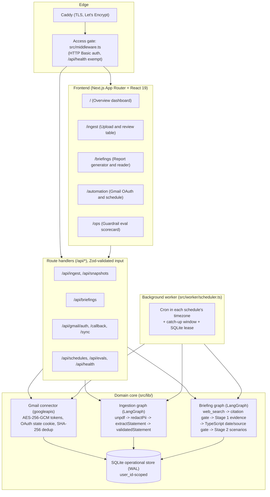

# LedgerPulse — High-Level Design (HLD)

**LedgerPulse** is the TypeScript and Next.js sister application to `portfolio-briefing-agent`. It replaces the single-user local Streamlit/Python prototype with a web application backed by a `user_id`-scoped store, automated Gmail ingestion of IBKR Daily Activity Statements, a background scheduler, and a Docker/VPS deployment.

---

## 1. System topology

The web app and the worker are separate processes (separate containers in Docker) that share only the SQLite database volume.

---

## 2. Python-to-TypeScript migration map

| Capability | `portfolio-briefing-agent` (Python) | `LedgerPulse` (TypeScript) |
|---|---|---|
| **Web UI** | `app.py` (Streamlit, localhost-only) | Next.js 15 App Router + React 19 + Tailwind CSS (`src/app/*`) |
| **Access control** | None (localhost only) | HTTP Basic sign-in in `src/middleware.ts`, mandatory in production |
| **Schema & invariants** | `portfolio_agent/models.py` (Pydantic v2) | `src/lib/agent/models.ts` (strict Zod + `zodResponseFormat`) |
| **PDF parsing & PII** | `pypdf` + regex (`services.py`) | `unpdf` + `redactPii()` (`src/lib/agent/services.ts`, `src/lib/telemetry.ts`) |
| **Orchestration** | `langgraph` Python `StateGraph` | `@langchain/langgraph` TypeScript `StateGraph` (`src/lib/agent/workflow.ts`) |
| **Web search & synthesis** | `ChatOpenAI` + `web_search` | `openai.responses.create` (`web_search_preview`, `max_tool_calls: 2`, `store: false`) |
| **Email ingestion** | Manual upload only | Gmail OAuth2 (`gmail.readonly`) + SHA-256 deduplication (`src/lib/gmail/client.ts`) |
| **Operational store** | Local SQLite (`data/app.sqlite`) | `user_id`-scoped SQLite WAL (`src/lib/db/store.ts`) |
| **Scheduler** | None (manual CLI/UI) | `worker` container: cron per user/timezone, durable `run_leases` (`src/worker/scheduler.ts`) |
| **Evaluation suite** | `pytest` + `evals.py` | `vitest` + `npm run eval` (`src/lib/agent/evals.ts`) |

---

## 3. Scheduling model

Each user has one row in `schedules`: a 5-field cron expression evaluated in the schedule's IANA timezone (default `0 18 * * 1-5`, 18:00 Monday–Friday), an optional Monday–Friday restriction, and the research settings (news window, instrument cap, language).

On every poll (`WORKER_POLL_INTERVAL_MS`, default 60 s) the worker:

1. Finds each enabled schedule's most recent occurrence within a 24-hour catch-up window, so a run missed during a restart is still performed once.
2. Treats the schedule as due only if that occurrence is later than `last_run_at` (or, for a schedule that never ran, later than when it was last saved).
3. Skips users without a Gmail connection without consuming the occurrence, so connecting Gmail later the same evening still runs it.
4. Takes the per-user lease `scheduled-sync:{userId}` (one atomic UPSERT, unique owner per attempt), re-checks due-ness, runs sync, ingestion and briefing, records `last_run_at`, and releases the lease.

A failed run is logged once (`scheduler_tick_error`) and is not retried until the next occurrence, so a persistent error (revoked token, exhausted quota) cannot generate a model bill or an audit entry every minute. **Fetch IBKR Email Now** on the Automation page remains available for manual retries. Ticks are chained rather than run with `setInterval`, so a slow run never overlaps the next poll.

---

## 4. Multi-tenant scaling path

LedgerPulse is ready for a single VPS today and keeps clear seams for growth:

1. **Tenant isolation (`user_id` partitioning)**
   - `snapshots`, `briefing_runs`, `ingestion_jobs`, `oauth_connections` and `schedules` carry a `user_id` foreign key; `audit_events` and `delivery_outbox` carry `user_id` without a foreign key. Every request-path store read is filtered by `user_id`; only the worker's schedule and outbox scans span tenants, by design.
   - Identity is **not** authenticated per user yet. `resolveUserId()` in `src/lib/tenant.ts` returns `DEFAULT_USER_ID` or a development-only `x-ledgerpulse-user` header, behind one shared deployment password. Before onboarding a second person, resolve the user id from a verified session (NextAuth, Clerk, Auth0, …) in `resolveUserId()`; no other module needs to change.
2. **Database (SQLite → PostgreSQL)**
   - `OperationalStore` (`src/lib/db/store.ts`) keeps all SQL behind typed repository methods. Moving to `pg`/Drizzle + PostgreSQL row-level security changes the store, not the LangGraph workflows or the UI.
3. **Worker (polling loop → queue)**
   - The worker polls schedules and coordinates through SQLite leases. At higher scale the same due-check can enqueue `(userId, occurrence)` jobs into Redis/BullMQ so several stateless workers process syncs and research in parallel.
4. **Cost and rate-limit governance**
   - Every run enforces `maxInstruments` (1–10) and `max_tool_calls: 2` per instrument, and `briefing_runs` records token usage and estimated USD spend per `user_id`, ready for quotas or billing.
