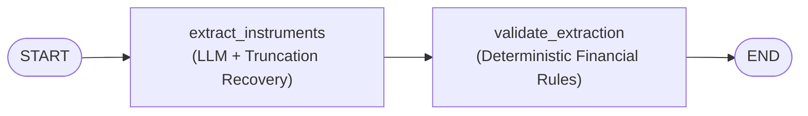
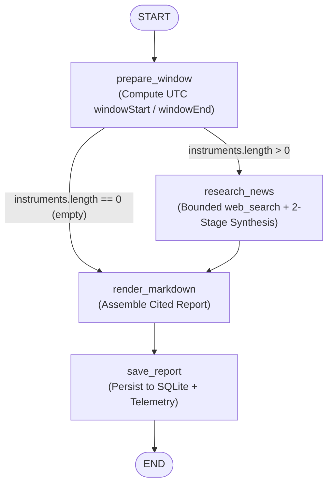

# LangGraph Study Guide: Ingestion Graph & Briefing Graph

If you are new to **LangChain** and **LangGraph**, this guide walks through how **LedgerPulse** implements both workflows in [`src/lib/agent/workflow.ts`](../src/lib/agent/workflow.ts) and [`src/lib/agent/services.ts`](../src/lib/agent/services.ts).

---

## 1. Core LangGraph Concepts Used Here

Think of a LangGraph `StateGraph` as a **typed state machine** made of three building blocks:

1. **State (`Annotation.Root`)**: A shared typed object passed from step to step. Every node reads from this state and returns a *partial update* object (only the fields it changed), which LangGraph merges back into the state.
2. **Nodes (`.addNode(name, fn)`)**: Async functions `(state) => partialStateUpdate`. A node can call an LLM, run deterministic validation, or write to SQLite.
3. **Edges (`.addEdge` & `.addConditionalEdges`)**: Control flow between nodes, starting at `START` and finishing at `END`.
4. **Compile & Invoke (`.compile()` / `.invoke(initialState)`)**: Compiling validates the graph structure and returns a runnable workflow.

> **Why two separate graphs instead of one?**
> - **Ingestion (`buildIngestionGraph`)** is a *write-once, human-reviewed* pipeline: you upload or sync a PDF once, inspect the extracted positions, and save a confirmed snapshot.
> - **Briefing (`buildBriefingGraph`)** is a *repeatable read/research* pipeline: you can re-run it daily, switch the lookback window (`1` vs `7` days), or change languages (`English` vs `Chinese`) from the saved snapshot without re-parsing the PDF.

---

## 2. The Ingestion Graph (`buildIngestionGraph`)

Defined in [`src/lib/agent/workflow.ts`](../src/lib/agent/workflow.ts#L53-L78).



### Step-by-Step Walkthrough

1. **State Definition (`IngestionAnnotation`)**:
   ```ts
   const IngestionAnnotation = Annotation.Root({
     text: Annotation<string>,            // Sanitized PDF/text with [PAGE N] markers
     pageCount: Annotation<number>,       // Total PDF pages (used for bounds check)
     statement: Annotation<Statement | undefined>, // Populated by extract_instruments
   });
   ```
2. **Node 1 — `extract_instruments`**:
   - Calls `extractor(state.text)` (defaults to `services.extractStatement(state.text)`).
   - Uses OpenAI strict JSON Schema structured output (`zodResponseFormat(StatementSchema, "statement")`).
   - If the PDF is huge (e.g., 58 positions) and hits `LengthFinishReasonError` at `5,000` tokens, `extractStatement()` retries at `16,000` tokens and, if still truncated, recursively splits the text on line boundaries while preserving `[PAGE N]` headers.
   - Returns `{ statement }` to update `state.statement`.
3. **Node 2 — `validate_extraction`**:
   - Pure deterministic TypeScript (no LLM call).
   - Calls `validatedStatement(state.statement, state.pageCount)` ([`models.ts`](../src/lib/agent/models.ts)):
     - Rejects any extracted `source_page > state.pageCount`.
     - Forces `holding_quantity = null` and `as_of = null` if `kind !== "holdings"` (so trade activity never masquerades as current holdings).
     - Deduplicates instruments and nulls conflicting quantities with an explicit warning.
4. **Dependency Injection for Testing**:
   - Notice `buildIngestionGraph(extractor = ...)` accepts a custom `extractor` function! That lets `evals.ts` and `vitest` test the entire graph offline at `$0` API cost by passing a fake extractor.

---

## 3. The Briefing Graph (`buildBriefingGraph`)

Defined in [`src/lib/agent/workflow.ts`](../src/lib/agent/workflow.ts#L80-L246).



### Step-by-Step Walkthrough

1. **State Definition (`BriefingAnnotation`)**:
   - Carries inputs (`userId`, `statement`, `confirmed`, `snapshotId`, `days`, `language`, `maxInstruments`) and outputs populated along the way (`windowStart`, `windowEnd`, `research`, `markdown`, `runId`, `telemetry`).
2. **Node 1 — `prepare_window`**:
   - Deterministic date math: computes `windowEnd = now` and `windowStart = now - days` in UTC ISO format.
3. **Conditional Edge (`.addConditionalEdges`)**:
   - Inspects `state.statement.instruments.length`:
     - If `> 0`, routes to `"research_news"`.
     - If `0`, skips `"research_news"` completely and jumps straight to `"render_markdown"` (saving API cost on empty statements).
4. **Node 2 — `research_news`**:
   - Slices `state.statement.instruments.slice(0, state.maxInstruments)` to enforce the per-run cost cap.
   - Loops through each instrument inside a `try / catch`:
     - Calls `researcher(item, windowStart, windowEnd, language)` (defaults to `services.researchInstrument()`).
     - If an individual ticker throws (e.g., network timeout), it catches the error, sanitizes it via `safeError()`, records `status: "failed"`, and continues researching the remaining tickers.
   - Inside `services.researchInstrument()` ([`services.ts`](../src/lib/agent/services.ts)):
     1. **Hosted Search**: Calls `openai.responses.create` with `web_search_preview` (`max_tool_calls: 2`, `store: false`).
     2. **Citation Gate (`normalizeResearchFromResponse`)**: Requires `search_calls > 0` and at least one valid `http`/`https` citation annotation; otherwise marks `status: "unverified"`.
     3. **Two-Stage Synthesis (`synthesizeResearch`)**:
        - **Stage 1 (`EvidenceSchema`)**: Extracts `NewsFact[]` with dates and `source_ids`.
        - **Deterministic Python/TS Gate (`eligibleNews`)**: Drops undated, out-of-window, or invalid-source facts.
        - **Stage 2 (`ScenariosSchema`)**: Runs *only* if accepted facts remain, receiving **only** `accepted_news` (zero contamination from rejected articles).
5. **Node 3 — `render_markdown`**:
   - Deterministic template builder: formats the Markdown report, omits prose for `status === "unverified"` items, prints snapshot age warnings, and lists any tickers skipped by `maxInstruments`.
6. **Node 4 — `save_report`**:
   - Calls `activeStore.recordRun(...)` ([`db/store.ts`](../src/lib/db/store.ts)) to persist the Markdown report, token/USD telemetry, and guardrail audit events (`dated_evidence_filtered`, `unverified_withheld`, `research_failure_isolated`) into SQLite.

---

## 4. How `runBriefing()` Calls the Graph

In [`runBriefing()`](../src/lib/agent/workflow.ts#L248-L306):
- Validates bounds (`1 <= days <= 30`, `1 <= maxInstruments <= 10`).
- Compiles the graph with `buildBriefingGraph(params.researcher, params.store)`.
- Invokes `.invoke({ ...initialState })` and returns `{ runId, markdown, research, telemetry, windowStart, windowEnd }`.

### Try Tracing It Yourself
1. Read [`src/lib/agent/workflow.ts`](../src/lib/agent/workflow.ts) top-to-bottom (~300 lines).
2. Run `npm run eval` — `evals.ts` executes both `buildIngestionGraph` and `runBriefing` with mock extractors/researchers so you can see every guardrail branch fire in `< 2 seconds` at `$0` cost.
