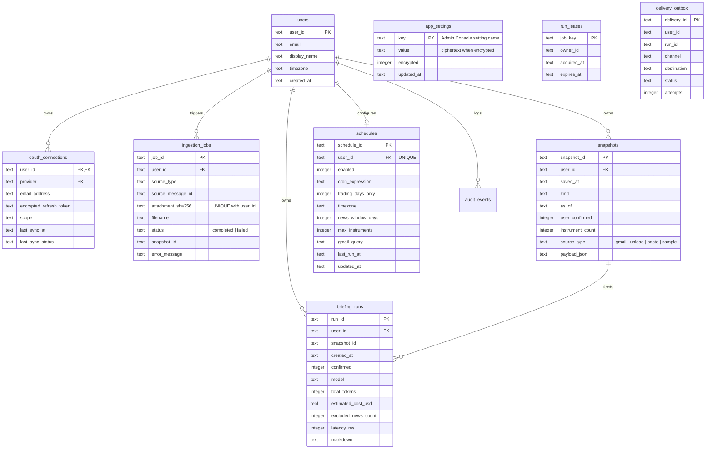
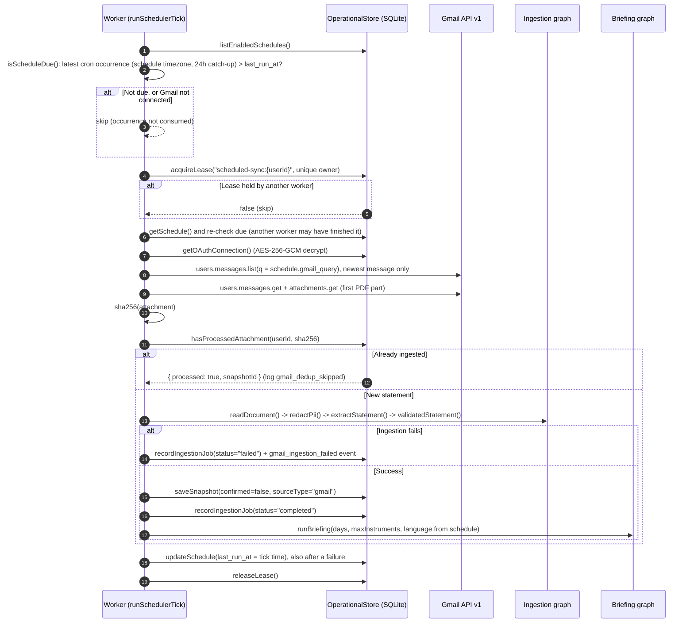

# LedgerPulse — Low-Level Design (LLD)

This document covers the database schema, the scheduled Gmail sync sequence, and the contracts of each module, so engineers can understand and extend the codebase quickly.

---

## 1. Relational data model (`src/lib/db/store.ts`)

Notes:

- `briefing_runs.snapshot_id`, `audit_events.user_id` and `delivery_outbox.user_id` are logical references without foreign-key constraints.
- `audit_events.event_key` is `UNIQUE`; events written with a key (for example `schedule-invalid:{userId}:{updated_at}`) are recorded at most once.
- The store opens a short-lived connection per call with `journal_mode=WAL` and `foreign_keys=ON`, so the web and worker processes can share the file safely.

---

## 2. Scheduled Gmail sync sequence

The Automation page's sync button (`POST /api/gmail/sync`) runs the same sync without a lease or a briefing. When Gmail is not configured or not connected, it uses a built-in fictional statement instead, saved with `source_type = "sample"`.

---

## 3. Module reference

### `src/lib/agent/models.ts`
- **`InstrumentSchema` / `StatementSchema`**: strict Zod schemas compiled to OpenAI JSON Schema via `zodResponseFormat`.
- **`validatedStatement(statement, pageCount?)`**:
  - Forces `holding_quantity = null` and `as_of = null` whenever `kind !== "holdings"`, and drops invalid `as_of` dates with a warning.
  - Rejects `source_page > pageCount` and quantities that are not finite decimals (thousands separators are removed).
  - Merges duplicates by `(symbol || name, exchange, asset_type)`. A `null` quantity means "not stated on this row" and never overrides an explicit one; numerically equal quantities (`"250"` and `"250.0000"`) agree; two different explicit quantities null the quantity permanently, with a warning.

### AI configuration: `src/lib/ai-settings-catalog.ts`, `src/lib/ai-settings.ts`, `src/lib/agent/llm-config.ts`, `src/lib/agent/llm.ts`
- **Catalog** (`ai-settings-catalog.ts`, client-safe): every editable AI setting with its label, `.env` aliases, default and help text, including the per-task model guidance shown in the Admin Console.
- **Storage** (`ai-settings.ts`):
  - Admin Console values live in `app_settings`; secrets are AES-256-GCM encrypted.
  - `aiEnv()` layers the saved values over `process.env`, so the precedence is Admin Console, then environment, then default. With `strict`, a secret that no longer decrypts is an error rather than a silent fallback.
  - `saveAiSettings()` validates the whole patch before writing anything and audits the key names (never values).
  - `aiSettingsState()` reports each setting's source without returning secret values.
- **Resolution** (`llm-config.ts`, pure): `resolveAiConfig(env)` validates and returns the endpoint, the per-task models (`extraction`, `analysis` defaulting to extraction, `research`), the web search provider, the Brave settings and pricing. Every setting is validated before a request is sent:
  - The base URL must be http(s) with no embedded credentials or fragment; its query string becomes a default query on every request.
  - Headers must be a JSON object of valid names and string values.
  - The key may be omitted only when a gateway is set.
  - Errors never echo URLs or header values.
- **Client** (`llm.ts`):
  - `loadAiConfig()` resolves the effective settings for each call.
  - `createLlmClient(config)` builds the single OpenAI-compatible client used by every model call.
  - `describeAiSetup()` names the search provider, the analysis model and the endpoint in report footers.

### `src/lib/agent/search.ts`
- **`braveSearch()`**: calls Brave's `news` or `web` search endpoint with `X-Subscription-Token`, passing `freshness=<start>to<end>` so only the briefing window is searched.
  - The web endpoint merges its news and web sections.
  - Results are kept only with credential-free http(s) URLs, are de-duplicated, and have highlight markup and entities stripped. `page_age` becomes the publication date.
  - Failures map to specific messages: rejected key (401/403), rate limit (429), the validation detail for other statuses, or timeout.

### `src/lib/agent/services.ts`
- **`errorKind(err)` / `safeError(err)`**: OpenAI SDK v4 error classes leave `name` as `"Error"`, so errors are classified with `instanceof`. `safeError` maps each kind to an actionable message. For 400, 404 and 422 errors it adds the provider's message when that message is short and doesn't look like it contains a credential.
- **`readDocument(data, filename)`**: enforces the 10 MB, 80-page and 120,000-character limits, verifies the `%PDF-` signature, rejects pages with under 10 characters of text (scans; no OCR), tags pages `[PAGE N]`, and runs `redactPii()`.
- **`extractStatement(text)`**: adaptive truncation recovery, starting at `max_tokens: 5000`. On `LengthFinishReasonError` (the SDK raises it when `finish_reason` is `length`) it retries at `16000`, then calls `splitBatch()` on a line boundary, re-injecting the active `[PAGE N]` marker, and passes the first 800 characters as untrusted context to continuation batches (recursion depth ≤ 4).
- **`researchInstrument()`**: dispatches on `WEB_SEARCH_PROVIDER`.
  - `openai`: the research model with the Responses API's hosted `web_search_preview` (at most 2 tool calls).
  - `model`: the research model via Chat Completions `web_search_options`, reading `url_citation` annotations; each request counts as one search call.
  - `brave`: one Brave request (10 results). The results become numbered evidence lines (`[source N] title (host, published date): snippet`) for the analysis model, with no research-model call.
  - Each instrument carries `cost_usd`: research tokens and searches at the research model's (or Brave's) rate, plus analysis tokens at the analysis model's rate. Run telemetry sums these.
- **`normalizeResearchFromResponse()`**: keeps only `url_citation` annotations whose URL normalizes to a credential-free `http(s)` href, replaces annotated spans with Markdown links right-to-left, and skips any span overlapping one already replaced. Every source is still listed in the report. Status is `cited` only when there was at least one search call and one valid source.
- **`synthesizeResearch(result, startIso, endIso, language)`**:
  - **Stage 1 (`EvidenceSchema`)**: extracts `NewsFact[]` with an explicit `publication_date` and `source_ids`.
  - **Deterministic gate (`eligibleNews()`)**: drops facts with no date, a date outside `[startIso, endIso]` (whole UTC calendar days), or no valid source id.
  - **Stage 2 (`ScenariosSchema`)**: runs only if accepted facts remain, and sees only `accepted_news`, never raw search text or rejected facts.

### `src/lib/agent/workflow.ts`
- **`buildIngestionGraph()`**: `START -> extract_instruments -> validate_extraction -> END`.
- **`buildBriefingGraph()`**: `START -> prepare_window -> (conditional: research_news | render_markdown) -> render_markdown -> save_report -> END`. `prepare_window` stamps `startedAtMs`, and `save_report` records end-to-end latency from it.
- **`runBriefing()`** rejects non-integer or out-of-range bounds (`1–30` days, `1–10` instruments), including `NaN`.

### `src/lib/cron.ts`
- Dependency-free 5-field cron (`*`, values, ranges, lists, steps, `JAN`–`DEC`/`SUN`–`SAT`, weekday `7` = Sunday; day-of-month and day-of-week are OR-ed when both are restricted, as in Vixie cron).
- **`mostRecentFireTime(expr, timeZone, now, lookbackMinutes, accept?)`** walks back over real UTC minutes and evaluates each in the timezone, so DST transitions need no special cases.

### `src/worker/scheduler.ts`
- **`isScheduleDue(schedule, now)`**, **`runSchedulerTick(store, { now?, sync? })`**: see the sequence above. Each schedule is isolated: an invalid stored timezone or cron produces one `schedule_invalid` audit event per schedule revision and never blocks other users. Returns one `TickResult` per schedule (`not_due`, `gmail_not_connected`, `locked`, `completed`, `failed`, `invalid_schedule`).

### `src/lib/db/store.ts`
- **`acquireLease(key, owner, ttl)`**: a single atomic UPSERT that takes the lease only if it is free, expired, or already held by the same owner (renewal). Owners must be unique per attempt.
- **`recordIngestionJob()`**: upserts by `(user_id, attachment_sha256)` but never demotes a `completed` job, so a later failure cannot cause re-ingestion.
- **`updateSchedule()`**: trusted internal API (the worker writes `last_run_at` through it); HTTP input goes through `SchedulePatchSchema` first.

### `src/lib/validation.ts`
- **`SchedulePatchSchema`**: the fields a client may change (cron, timezone, flags, bounds, language, query, delivery). It strips unknown keys, so the UI can PUT back the record it fetched without overwriting `last_run_at`, `schedule_id` or `user_id`.
- **`BriefingRequestSchema`**: `snapshotId`, integer `days` (1–30) and `maxInstruments` (1–10), `language`.

### `src/lib/gmail/client.ts` and `src/lib/gmail/oauth-state.ts`
- `GET /api/gmail/auth` issues `state = base64url({ n: nonce, u: userId })` and stores the nonce in the HttpOnly, SameSite=Lax cookie `lp_gmail_oauth_state` (path `/api/gmail`, 10 minutes). `/api/gmail/callback` links an account only when the state's nonce matches the cookie and the user id is well-formed, then clears the cookie.
- `syncAndAnalyzeIbkrFromGmail()` records failed ingestions (`ingestion_jobs.status = "failed"`, `gmail_ingestion_failed` event) and rethrows; the attachment remains unprocessed and is retried by the next sync.

### `src/lib/access.ts` and `src/middleware.ts`
- **`checkAccess(authorization, env)`**: HTTP Basic check against `APP_USERNAME` (default `admin`) / `APP_PASSWORD` using constant-time comparison. With no password it allows requests outside production, and in production it returns `503` unless `APP_AUTH_DISABLED=true`.
- The middleware runs on the Node.js runtime, so credentials are read from the runtime environment, and it exempts only `/api/health`.

### `src/lib/telemetry.ts`
- **`redactPii(text)`**: removes labelled personal lines (`Account Number/ID/Holder/Name`, `Address`, `Email`, `Phone`, `Tax ID`, `SSN`, `TIN`, `IBAN`, `SWIFT`), SSN/TIN patterns, inline emails, and IBKR account ids (`U1234567`, `DU1234567`).
- **`encryptSecret` / `decryptSecret`**: AES-256-GCM with `TOKEN_ENCRYPTION_KEY` (64 hex chars). A malformed key is an error, never silently replaced. Production requires the key; outside production a key derived from `OPENAI_API_KEY` is used. Decrypting with a changed key fails with a "reconnect Gmail" message.
- **`computeRunTelemetry()` / `estimateCostUsd()`**: per-run status counts, citation rate, tokens, search calls and estimated USD cost.
