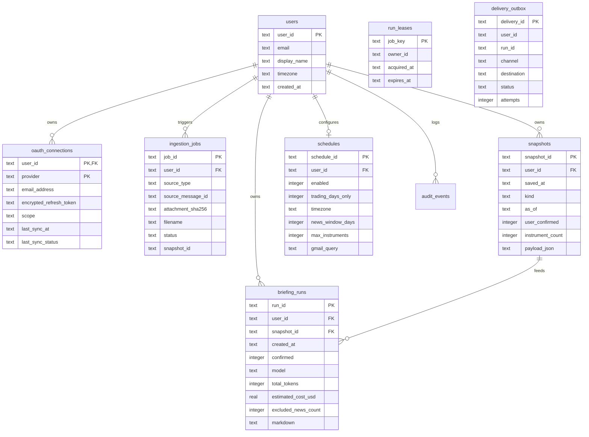
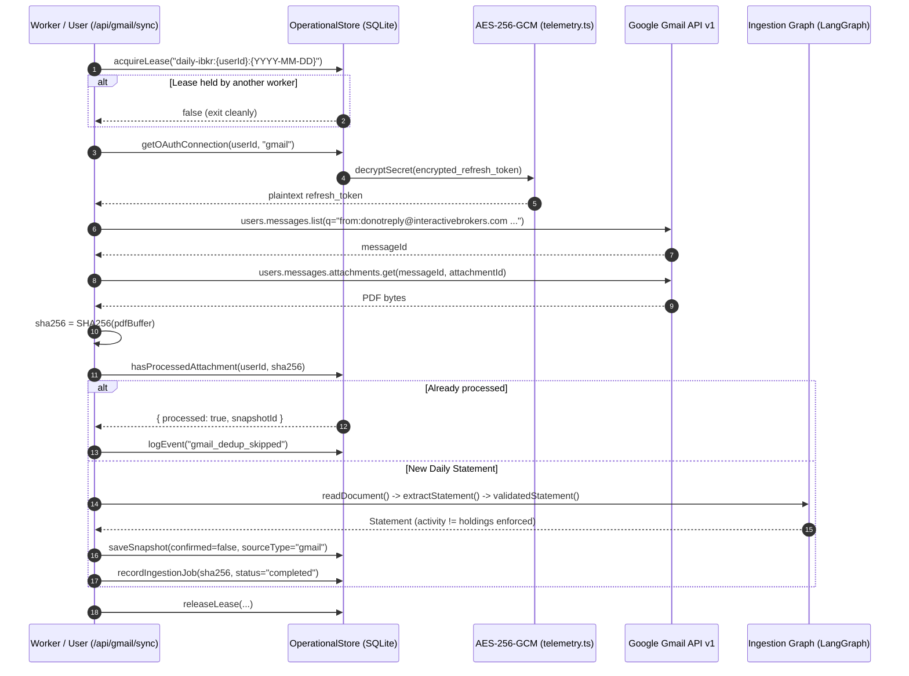

# LedgerPulse — Low-Level Design (LLD)

This document details the database schema, state machines, Gmail OAuth2 & deduplication sequence, and two-stage evidence isolation contracts so engineers can understand and extend the codebase quickly.

---

## 1. Relational Data Model (`src/lib/db/store.ts`)

---

## 2. Gmail IBKR Auto-Sync & Deduplication Sequence

---

## 3. Module-by-Module Reference

### `src/lib/agent/models.ts`
- **`InstrumentSchema` & `StatementSchema`**: Strict Zod schemas (`strict()`) compiled to OpenAI JSON Schema via `zodResponseFormat`.
- **`validatedStatement(statement, pageCount?)`**:
  - Forces `holding_quantity = null` and `as_of = null` whenever `statement.kind !== "holdings"`.
  - Rejects `source_page > pageCount`.
  - Deduplicates instruments by `(symbol || name, exchange, asset_type)` and nulls `holding_quantity` with a warning if duplicate rows disagree.

### `src/lib/agent/services.ts`
- **`readDocument(data, filename)`**: Checks 10 MB / 80-page limits, verifies `%PDF-` signature, extracts per-page text via `unpdf`, rejects scanned/empty pages (`< 10 chars`), tags pages `[PAGE N]`, and runs `redactPii()`.
- **`extractStatement(text)`**: Adaptive truncation recovery. Starts at `max_tokens: 5000`; on `LengthFinishReasonError`, retries at `16000`; if still truncated, calls `splitBatch()` on `\n` boundaries while re-injecting the active `[PAGE N]` marker and document header (`text.slice(0, 800)`).
- **`synthesizeResearch(result, startIso, endIso, language)`**:
  - **Stage 1 (`EvidenceSchema`)**: Extracts `NewsFact[]` with explicit `publication_date` and `source_ids`.
  - **Deterministic Gate (`eligibleNews()`)**: Rejects `publication_date === null`, dates outside `[startIso, endIso]` (UTC calendar-day granularity), and out-of-range `source_ids`.
  - **Stage 2 (`ScenariosSchema`)**: Invoked *only* if `accepted.length > 0`, receiving only `accepted_news`—never raw search text or rejected articles.

### `src/lib/agent/workflow.ts`
- **`buildIngestionGraph()`**: `START -> extract_instruments -> validate_extraction -> END`.
- **`buildBriefingGraph()`**: `START -> prepare_window -> (conditional: research_news | render_markdown) -> render_markdown -> save_report -> END`.

### `src/lib/telemetry.ts`
- **`redactPii(text)`**: Strips `Account Number/Holder`, `Address`, `Email`, `Phone`, `Tax ID/SSN`, `IBAN/SWIFT`, and inline email addresses.
- **`encryptSecret` / `decryptSecret`**: AES-256-GCM authenticated encryption using `TOKEN_ENCRYPTION_KEY` (32-byte hex).
